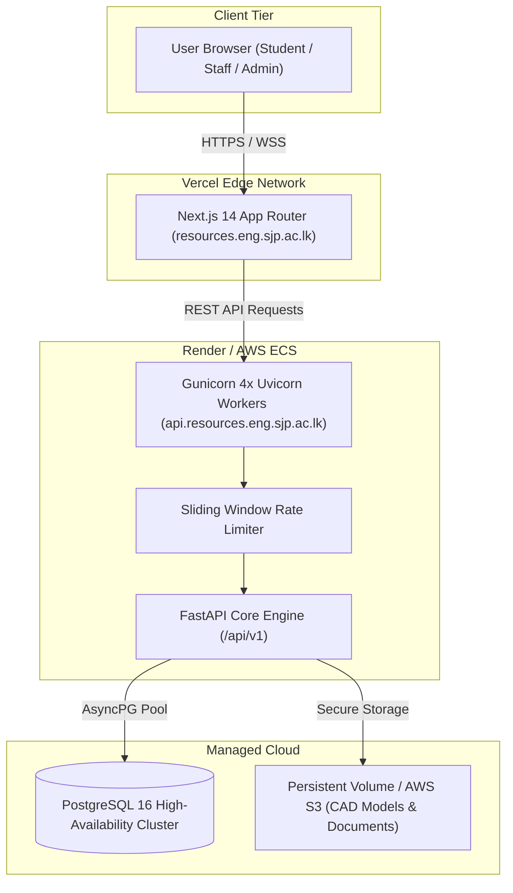

# Production Deployment Documentation

This guide covers complete deployment procedures for the **University of Sri Jayewardenepura Faculty of Engineering Resource Management System** across **Vercel** (Frontend), **Render** / **AWS** (Backend), and **Managed PostgreSQL**.

---

## Architecture Topology



---

## 1. Frontend Deployment (Vercel)

The Next.js 14 App Router frontend is optimized for zero-configuration deployment on Vercel.

### Step 1: Connect Git Repository
1. Log in to [Vercel Dashboard](https://vercel.com).
2. Click **Add New Project** and select your GitHub/GitLab repository.
3. Set **Root Directory** to `frontend`.

### Step 2: Configure Environment Variables
In the Vercel project settings, add:
| Variable | Value | Description |
|---|---|---|
| `NEXT_PUBLIC_API_URL` | `https://api.resources.eng.sjp.ac.lk/api/v1` | Public backend API endpoint |
| `NODE_ENV` | `production` | Production mode |

### Step 3: Deploy
1. Click **Deploy**. Vercel will run `npm ci` and `npm run build` using the configured [`frontend/vercel.json`](file:///C:/Users/USER/.gemini/antigravity/scratch/usj-foe-resource-manager/frontend/vercel.json).
2. Configure your custom institutional domain (e.g., `resources.eng.sjp.ac.lk`) in **Settings &rarr; Domains** and add the CNAME record in your university DNS provider.

---

## 2. Backend Deployment (Render)

Render provides managed container hosting and PostgreSQL clusters with automatic SSL.

### Method A: Blueprint Deployment with `render.yaml`
1. Navigate to [Render Dashboard](https://dashboard.render.com).
2. Click **Blueprints** &rarr; **New Blueprint Instance**.
3. Select this repository. Render automatically reads [`render.yaml`](file:///C:/Users/USER/.gemini/antigravity/scratch/usj-foe-resource-manager/render.yaml) and creates:
   - Managed PostgreSQL database `usj-foe-postgres` (PostgreSQL 16)
   - Web Service `usj-foe-backend` running [`backend/Dockerfile.prod`](file:///C:/Users/USER/.gemini/antigravity/scratch/usj-foe-resource-manager/backend/Dockerfile.prod)

### Method B: Manual Render Setup
1. **Create Managed Database**:
   - PostgreSQL 16 &rarr; Name: `usj-resource-db` &rarr; Region: `Singapore` (ap-southeast-1).
   - Copy the **Internal Connection String**.
2. **Create Web Service**:
   - Environment: `Docker`
   - Docker Context: `./backend`
   - Dockerfile Path: `./backend/Dockerfile.prod`
   - Health Check Path: `/health`
   - Port: `8000`
3. **Environment Variables**:
   - `DATABASE_URL`: Set to connection string with `postgresql+asyncpg://` protocol.
   - `JWT_SECRET_KEY`: Generate using `openssl rand -hex 32`.
   - `BACKEND_CORS_ORIGINS`: `["https://resources.eng.sjp.ac.lk"]`
   - `RATE_LIMITING_ENABLED`: `true`
   - `MAX_UPLOAD_SIZE_MB`: `50`

---

## 3. Alternative Backend Deployment (AWS App Runner / ECS)

### AWS App Runner:
1. Build and push image to Amazon Elastic Container Registry (ECR):
   ```bash
   aws ecr get-login-password --region ap-southeast-1 | docker login --username AWS --password-stdin <aws_account_id>.dkr.ecr.ap-southeast-1.amazonaws.com
   docker build -t usj-foe-backend -f backend/Dockerfile.prod ./backend
   docker tag usj-foe-backend:latest <aws_account_id>.dkr.ecr.ap-southeast-1.amazonaws.com/usj-foe-backend:latest
   docker push <aws_account_id>.dkr.ecr.ap-southeast-1.amazonaws.com/usj-foe-backend:latest
   ```
2. Create App Runner service pointing to ECR image.
3. Attach Amazon RDS PostgreSQL instance in private VPC.
4. Set health check endpoint to `/health` (HTTP 200).

---

## 4. Local Multi-Container Development (Docker Compose)

To run the entire ecosystem locally with live database and caching:

```bash
docker-compose up --build
```

- **Frontend Portal**: `http://localhost:3000`
- **Backend API Docs (Swagger UI)**: `http://localhost:8000/api/v1/docs`
- **Backend Health Check**: `http://localhost:8000/health`
- **PostgreSQL**: `localhost:5432` (`postgres` / `postgres`)

To tear down:
```bash
docker-compose down -v
```

---

## 5. Security Checklist Before Going Live

- [x] Change all default passwords and secrets (`JWT_SECRET_KEY`, `POSTGRES_PASSWORD`).
- [x] Enforce institutional email domains (`eng.sjp.ac.lk`, `sjp.ac.lk`).
- [x] Enable rate limiting on authentication routes (`RATE_LIMITING_ENABLED=true`).
- [x] Restrict CORS origins strictly to institutional frontend domains.
- [x] Enable SSL (`?ssl=require` on PostgreSQL connection string).
- [x] Apply least privilege to database users (non-root Linux user `appuser` in Docker container).
- [x] Run `alembic upgrade head` before serving traffic.
